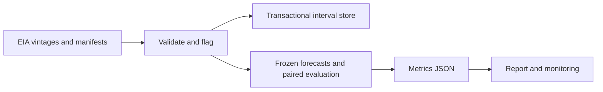

# California Grid Analytics

Audited demand revisions, day-ahead forecast comparisons and reproducible interval operations.

### Executive summary

Across 265 matched delivery days, the geometric mean of the five authority-level model-to-operator MAE ratios was 1.471, with a one-sided 95% upper bound of 1.571. A ratio of 1 denotes parity. The result supports retaining the operator forecasts across the five authorities. The model recorded lower mean daily errors for CISO (1,486 versus 2,161 MW) and LDWP (243 versus 305 MW), but interpreting those differences requires checking demand definitions and hour alignment.

BANC's retrospective queue changed from 2 to 0 to 3 flagged hours as adjusted readings and then the revised peak were applied. In 2024, both rules captured 0 of 1 catalog event days at a 12-day review budget. In 2025, both rules captured 0 of 0 catalog event days at a 12-day review budget. Recall is undefined when no qualifying event exists.

The post-freeze shift check lowers CISO operator hourly MAE from 2,160.6 to 1,966.5 MW when demand is taken from the following UTC hour. This does not establish the correct timestamp convention. Across the seasonal weeks, CISO EIA forecasts agree with OASIS DAM within 0.24-0.26 MW mean absolute difference, but adjusted actuals differ by 241-1,192 MW. LDWP's sampled ratio changes from 0.855 to 4.454 when OASIS actuals replace its EIA target. This supports a demand-definition caveat, not a superiority claim.

### Results

| Authority | Model daily MAE (MW) | Operator daily MAE (MW) | Ratio |
| --- | ---: | ---: | ---: |
| BANC | 174.0 | 55.3 | 3.145 |
| CISO | 1,486.5 | 2,160.6 | 0.688 |
| IID | 53.5 | 28.7 | 1.862 |
| LDWP | 243.1 | 304.7 | 0.798 |
| TIDC | 24.2 | 11.3 | 2.141 |


The aggregate ratio and its upper bound support retaining operator forecasts.


The hourly bias pattern requires demand-definition and timestamp checks before interpreting CISO model gains.

### Reproduce

```bash
python -m pip install -r requirements-release.txt
make demo
make report
```

The demo creates isolated synthetic inputs, runs the pipeline and executes the tests. Reports read saved metric JSON. Archived inputs are needed for the strict frozen replay:

```bash
python -m src.replay_benchmark --freeze-ref spec-frozen-v1
```

### Pipeline and repository map



The pipeline preserves revisions and separates frozen evaluation from post-freeze checks.

`src/` holds analysis and publication code. `dags/` holds interval orchestration. `config/` records the frozen design. `outputs/metrics/` holds versioned evidence. `tests/` exercises contracts. `docs/` explains findings and limits.

### Verification and further reading

The strict JSON replay fails because Prophet metrics differ. All other fields match exactly. Two same-environment repeated fits agree. The cause remains unresolved. All eight seasonal OASIS files validate. Docker operation and hosted CI are unverified. The reviewed literature source is missing.

[Employer PDF](reports/California_Grid_Analytics_Report_Sileshi_Hirpa.pdf) · [Full report](docs/report.md) · [Literature review status](docs/literature_review.md) · [Implementation audit](docs/implementation_audit.md) · [Freeze scope](docs/freeze_scope.md) · [Tableau Public](https://public.tableau.com/app/profile/sileshi.hirpa1285/viz/CaliforniaGridStressMonitoringDashboard/ExecutiveOverview)

<details>
<summary>Historical exploratory snapshot</summary>

<!-- baseline:start -->
The CSV contains 158,182 raw rows. The California analysis retained 13,020 authority-hours and flagged 75 for review.

| Authority | Eligible hours | Mean reported demand (MW) | High-priority hours |
|---|---:|---:|---:|
| BANC | 2,614 | 1,863.82 | 2 |
| CISO | 2,585 | 24,332.09 | 25 |
| IID | 2,615 | 348.15 | 16 |
| LDWP | 2,591 | 2,550.59 | 13 |
| TIDC | 2,615 | 281.16 | 19 |
<!-- baseline:end -->

</details>
