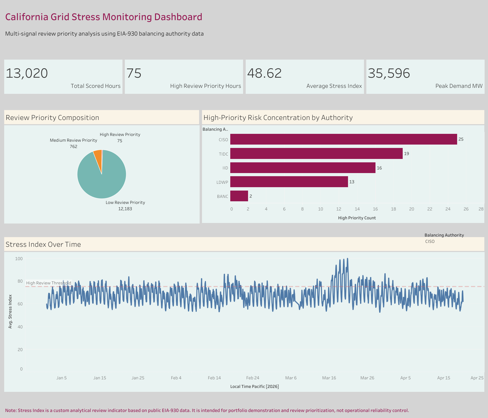

# California Grid Operations Analytics

Sileshi Hirpa | Arizona State University

This project uses EIA-930 hourly operating data to study electricity demand across California balancing authorities. The batch pipeline validates a local CSV, calculates retrospective demand indicators, writes SQL reporting tables and exports data for Tableau.

## Historical snapshot

<!-- baseline:start -->
The CSV contains 158,182 raw rows. The California analysis retained 13,020 authority-hours and flagged 75 for review.

| Authority | Eligible hours | Mean reported demand (MW) | High-priority hours |
|---|---:|---:|---:|
| BANC | 2,614 | 1,863.82 | 2 |
| CISO | 2,585 | 24,332.09 | 25 |
| IID | 2,615 | 348.15 | 16 |
| LDWP | 2,591 | 2,550.59 | 13 |
| TIDC | 2,615 | 281.16 | 19 |
<!-- baseline:end -->

High priority means reported demand reached at least 90% of that authority’s highest observed demand in the snapshot after rounding. These hours are candidates for retrospective review. The weighted demand, imports and forecast-error composite is a separate measure.

## Reproduce the historical run

Use Python 3.11 and the exact bulk CSV described in the [data manifest](data/manifest/eia930-9b0b83506002.json). Place it in data/raw/. Run from an isolated checkout, since the standalone pipeline refreshes the local database and exports.

```bash
python -m venv .venv
source .venv/bin/activate
pip install -r requirements-phase0.txt
unset DATABASE_URL
export USE_EIA_API=false
python dags/california_grid_daily_pipeline.py
python -m src.verify_snapshot
PYTEST_DISABLE_PLUGIN_AUTOLOAD=1 python -m pytest -q
```

The verifier checks the input hash, regenerates the source profile and metrics, and compares per-authority counts to the SQLite tables. The output-dependent tests require the pipeline run first. Raw observations are distributed separately. The API client uses the EIA v2 electricity/rto/region-data/data/ route. Scheduled Airflow, live API ingestion and PostgreSQL operation require separate verification.

## Research questions

- At a fixed issue time on the preceding day, how does a local model compare with the balancing authority’s published forecast on matched delivery hours?
- Which retrospective review hours change when the published demand is revised, and how much of the change follows from recalculating the peak?

The historical forecasting and spatial summaries are superseded. The archived runs used inconsistent evaluation windows, and the LightGBM run selected boosting rounds on its reported test set. The day-ahead result remains open.

[Evaluation design](docs/evaluation_spec.md) · [Measurement definitions](docs/measurement_definitions.md) · [Upgrade roadmap](docs/grid_upgrade_roadmap.md)

## Reporting

The [SQL queries](sql/) summarize daily demand and rank hours for review. The [Tableau workbook](tableau/) provides an executive overview, a review queue and authority comparisons. [Explore the published dashboard](https://public.tableau.com/app/profile/sileshi.hirpa1285/viz/CaliforniaGridStressMonitoringDashboard/ExecutiveOverview).


