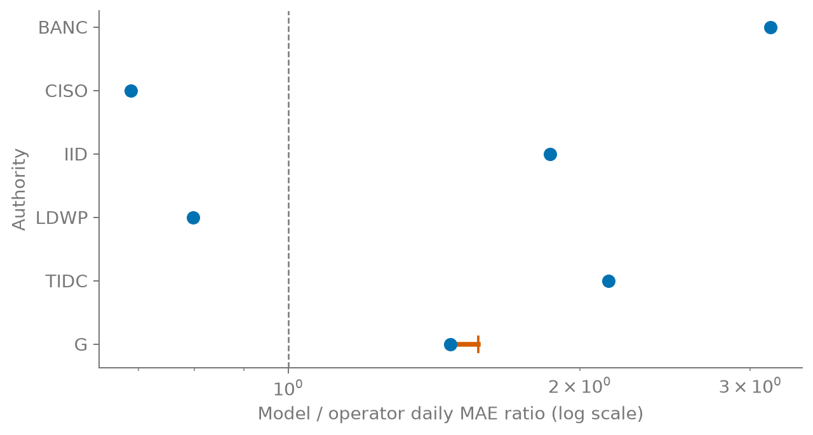

# California grid analytics report

## Business questions and decisions

The release supports retaining operator forecasts and auditing demand definitions before considering a model shadow trial. Across 265 matched delivery days, the geometric mean of the five authority-level model-to-operator MAE ratios was 1.471, with a one-sided 95% upper bound of 1.571. A ratio of 1 denotes parity. The result supports retaining the operator forecasts across the five authorities. The model recorded lower mean daily errors for CISO (1,486 versus 2,161 MW) and LDWP (243 versus 305 MW), but interpreting those differences requires checking demand definitions and hour alignment.

The hiring decision this project informs is whether the analysis can connect a statistical comparison with an operational choice and a reproducible data contract. The forecast comparison asks whether a local issue-time model improves proportional error across the California authorities. A separate revision question asks which hours enter or leave a retrospective review queue when EIA changes demand. The event question asks whether a composite daily ranking captures documented alerts at the same review workload as a demand-only rule.

BANC's retrospective queue changed from 2 to 0 to 3 flagged hours as adjusted readings and then the revised peak were applied. In 2024, both rules captured 0 of 1 catalog event days at a 12-day review budget. In 2025, both rules captured 0 of 0 catalog event days at a 12-day review budget. Recall is undefined when no qualifying event exists.

No adoption margin has been specified. The frozen comparison does not justify deployment. The review queue is an analyst workload device. A high score does not establish an emergency or causation.

## Related work

Seasonal naive forecasts and chronological evaluation provide a transparent benchmark ladder. Hyndman and Athanasopoulos (2021) explain why forecasting methods should be assessed against simple comparators using genuinely later observations. Here the operator forecast is the primary comparator, while a previous-week local-hour rule and a trailing moving average help interpret the learned candidate. The project retains per-authority errors because proportional summaries can obscure the size of MW differences.

Kunsch (1989) develops block resampling for dependent observations. The release applies contiguous delivery-day blocks jointly across authorities so the resampled comparison retains within-block temporal and cross-authority pairing. That methodological precedent does not verify this dataset's stationarity. Block-length sensitivity and the amount of usable history remain part of the interpretation.

EIA's Hourly Electric Grid Monitor documentation is operational gray literature. It describes a physical accounting dataset subject to reporting and adjustment conventions. CAISO's OASIS documentation distinguishes actual demand and market-process forecasts. Those sources motivate checking definitions before interpreting a lower model error as a forecasting advantage. The current bulk headers expose net battery-generation fields, but net output alone cannot identify simultaneous gross charging and discharging across a fleet.

The event-history catalog is also gray literature. Its alert notices supply externally documented labels rather than a validation target constructed from the demand score itself. A small catalog limits any ranking comparison. A transmission-related watch may occur without unusually high demand, so missing a label can reveal a mechanism mismatch rather than a threshold error.

The requested reviewed literature source is unavailable. The [full-review status](literature_review.md) records this missing input. No wording or references from the absent review have been reconstructed. The verified bibliography below covers only the methodological and operational sources used in this report.

## Data and provenance

The forecast comparison uses archived EIA bulk vintages whose digests are recorded in the [source manifest](../data/manifest/benchmark_sources.json). The saved hourly parquet matches the published freeze hash. The separate historical quality snapshot has its own manifest and is not interchangeable with the forecast study's later bulk inputs.

The frozen test begins 2025-04-01 and ends before 2026-01-01. It contains 33,005 intended authority-hours. Eligibility leaves 31,794 matched hours across 265 common delivery days. Missing observations are not silently filled for evaluation. Source anomalies are flagged and retained. Duplicate handling and observed zeros are explicit quality categories.

Post-freeze OASIS downloads cover spring, summer, autumn and winter weeks. Every accepted ZIP was checked for its report item, market identifier, unique hourly CAISO timestamps, numeric MW values and complete requested coverage. HTTP success alone was insufficient. Raw inputs stay outside version control. The download manifest records request attempts, response outcomes and hashes. The holdout EIA files retrieved for storage checks match their frozen source digests.

Acquisition code first appears in the scoring commit and is outside the frozen code-hash list. The freeze tag was added after scoring and establishes replay resolution, not the time of scoring. See [freeze scope](freeze_scope.md).

## Quality audit and sequential attribution

BANC's retrospective queue changed from 2 to 0 to 3 flagged hours as adjusted readings and then the revised peak were applied. This sequential calculation separates a reading change from a threshold change. It avoids attributing every membership difference to the observation alone.

RQ2 uses authority-hours with both reported and adjusted demand in the historical snapshot. The initial queue divides reported demand by the reported peak, rounds the percentage to two decimals, and applies the fixed threshold. The intermediate queue substitutes adjusted demand while holding that original peak fixed. The final queue also substitutes the adjusted peak. Each transition reports retained, entered and exited hours.

The BANC reported peak is 9,770 MW and the adjusted peak is 3,243 MW. A revised maximum changes the denominator for every eligible hour. The final queue can therefore grow after the anomalous reported spike is corrected. This is a property of the retrospective rule and does not establish a change in actual operational risk.

The audit distinguishes missing calendar hours, observed nulls, zeros and conflicting duplicates. Balance residuals compare demand, net generation and interchange under each target version. Imbalance or a revision is flagged for interpretation rather than deleted to improve a score. The historical queue evidence remains separate from the later full-window forecast evaluation.

## Methodology: issue time and predictors

The forecast issue is 12:00 Pacific on the day before delivery. UTC hour-ending keys identify intervals. Their Pacific start date defines the delivery day. This preserves the actual intervals on daylight-saving clock changes instead of forcing every day into a constant-length grid.

The availability assumption subtracts 1 hour from issue time before selecting recent observations. It is an assumption about reporting delay, not evidence that each archived observation was available in that version at that instant. Retrospective bulk revisions can enter historical predictors without vintage proof. The operator forecast is likewise an archived comparator whose original publication-time availability has not been established by the bulk file alone.

Calendar predictors encode delivery hour, weekday and issue-to-target horizon. Demand features include the comparable previous-week local time, a trailing mean and the last available reading at the cutoff. Weekly lookup handles ambiguous or nonexistent wall-clock times as unavailable. The learned models train on reported historical demand. The retrospective primary target is adjusted demand. The saved predictions permit alternative target scoring without retraining.

Training is restricted to outcomes before the earliest issue-time cutoff in the next evaluation window. The complete last validation delivery day is discarded because its outcomes would otherwise arrive after the first test issue. This prevents an obvious boundary leak but cannot restore missing publication vintages. A change to availability policy would require a new development experiment rather than a revision to the frozen result.

## Methodology: windows, selection and inference

Candidate selection uses the chronological development window beginning 2025-01-01 and ending before 2025-04-01. The candidate pool is lightgbm, prophet, previous_week, moving_average. The frozen development selection chose lightgbm. Model rank is an observed result. No candidate is promoted by deleting unfavorable authority outcomes.

For each eligible authority and delivery day, the calculation averages absolute errors on identical matched target hours. It then averages daily MAE across common days. The authority ratio divides the candidate mean daily MAE by the operator mean daily MAE. G is the exponential of the mean log ratio across authorities. Each authority has equal proportional weight, and each eligible day has equal weight within an authority. This differs from pooling all MW errors, which would give large systems a larger influence.

Eligibility requires at least 90% of the actual delivery-day intervals with all comparator methods and the target observed. All authorities must have an eligible day for the joint panel. Undefined or nonpositive ratios prevent log-based inference. Coverage is reported beside the score so a favorable result cannot conceal selective exclusions.

The moving-block bootstrap resamples contiguous eligible delivery-day blocks jointly across authorities and recomputes the ratios and G. There are 2,000 replicates with seed 42. The upper bound uses the 95% quantile. Development loss autocorrelation selected 1-day blocks. The frozen block-length sensitivity is 1-day blocks: 1.571, 3-day blocks: 1.603, 7-day blocks: 1.637, 14-day blocks: 1.646. A bound above parity does not support the deployment claim.

## Methodology: revisions, events and definitions

Post-freeze sensitivity holds the saved forecasts fixed and changes the target or alignment. Adjusted and reported demand are scored separately. At forecast time t, a negative shift uses demand at an earlier UTC hour. Endpoint loss can alter common eligible days, so each variant reports its own coverage. The shift is a diagnostic and does not decide the correct clock convention.

The LDWP-only storage proxy adds the negative part of battery net generation to adjusted demand. Other authorities retain their original targets. CISO has no observed dedicated battery-generation values in the holdout bulk fields, so a CISO storage correction is unsupported. This removes net charging only when aggregate battery generation is negative. It cannot recover gross charging, does not handle simultaneous fleet charging and discharge, and does not subtract integrated, pumped or other storage. It is labeled exploratory. Official reporting instructions and implementation-specific definitions must be reconciled before treating it as a corrected target.

OASIS actual and DAM reports are compared on interval-ending UTC keys. CA ISO-TAC maps to CISO and LADWP maps to LDWP. The seasonal comparison changes only these authorities' target and optionally their operator forecast. Other authorities retain their EIA values. Those sampled-week G values are compared with a sampled-week baseline, not with the full-window headline.

Event validation uses trailing observations for normalization. The day score is the maximum hourly score, and a daily coverage rule excludes sparse days. Demand-only and composite rules select the same review budget in each annual window under reported and adjusted demand. The composite weights demand normalization, import reliance and forecast surprise. These same-day inputs support retrospective screening, not a day-ahead alert claim. Catalog coverage is checked, missed labels are retained, and recall is undefined for a year without qualifying events.

## Results: frozen headline

Across 265 matched delivery days, the geometric mean of the five authority-level model-to-operator MAE ratios was 1.471, with a one-sided 95% upper bound of 1.571. A ratio of 1 denotes parity. The result supports retaining the operator forecasts across the five authorities. The model recorded lower mean daily errors for CISO (1,486 versus 2,161 MW) and LDWP (243 versus 305 MW), but interpreting those differences requires checking demand definitions and hour alignment.

| Authority | Model daily MAE (MW) | Operator daily MAE (MW) | Ratio |
| --- | ---: | ---: | ---: |
| BANC | 174.0 | 55.3 | 3.145 |
| CISO | 1,486.5 | 2,160.6 | 0.688 |
| IID | 53.5 | 28.7 | 1.862 |
| LDWP | 243.1 | 304.7 | 0.798 |
| TIDC | 24.2 | 11.3 | 2.141 |

Coverage is 31,794 matched authority-hours from 33,005 intended over 265 matched delivery days. Reported-demand sensitivity gives G = 1.455. The upper bound remains above parity, so changing the retrospective target does not provide systemwide adoption evidence.

BANC's retrospective queue changed from 2 to 0 to 3 flagged hours as adjusted readings and then the revised peak were applied. The queue result is descriptive and concerns the separate historical quality snapshot.

## Results: post-freeze sensitivity

The post-freeze shift check lowers CISO operator hourly MAE from 2,160.6 to 1,966.5 MW when demand is taken from the following UTC hour. This does not establish the correct timestamp convention. Across the seasonal weeks, CISO EIA forecasts agree with OASIS DAM within 0.24-0.26 MW mean absolute difference, but adjusted actuals differ by 241-1,192 MW. LDWP's sampled ratio changes from 0.855 to 4.454 when OASIS actuals replace its EIA target. This supports a demand-definition caveat, not a superiority claim.

| Post-freeze target variant | G | Upper bound | Days |
| --- | ---: | ---: | ---: |
| adjusted shift -1 | 1.169 | 1.216 | 265 |
| adjusted shift +0 | 1.471 | 1.571 | 265 |
| adjusted shift +1 | 1.205 | 1.256 | 265 |
| reported shift -1 | 1.164 | 1.210 | 263 |
| reported shift +0 | 1.455 | 1.544 | 263 |
| reported shift +1 | 1.200 | 1.247 | 263 |
| seasonal original adjusted | 1.365 | 1.719 | 27 |
| seasonal oasis actual | 1.988 | 2.479 | 27 |
| seasonal oasis actual and operator | 2.025 | 2.539 | 27 |
| adjusted ldwp net battery charging proxy | 1.469 | 1.560 | 264 |

The storage proxy and shifted targets do not change the published headline. Seasonal OASIS substitutions have a different support from the full-window comparison. Their per-authority ratios and coverage are available in the [sensitivity JSON](../outputs/metrics/forecast_sensitivity.json).

CISO operator mean bias is -1,773.4 MW and LDWP mean bias is -264.7 MW under adjusted demand. Persistent level and hour-of-day differences support further definition checks. They do not establish which demand convention should be used.

In 2024, both rules captured 0 of 1 catalog event days at a 12-day review budget. In 2025, both rules captured 0 of 0 catalog event days at a 12-day review budget. Recall is undefined when no qualifying event exists. The event catalog is too sparse to establish detector superiority.

## Limitations and ethical considerations

The strict full-JSON frozen replay fails in the tested environment. Two repeated fits are identical within that environment. Only Prophet authority metrics differ from the publication. LightGBM, authority, previous-week, moving-average and headline fields match exactly. The fit sets no explicit Prophet seed or thread count. The original runtime is unavailable and the cause remains unresolved. The published JSON has been preserved.

The retrospective source archive cannot establish original release-time availability. Adjusted targets can differ from operationally observed demand. The storage proxy cannot identify a physically complete demand correction. Hour shifts can reduce error simply by aligning recurring shapes differently. Seasonal OASIS checks are a limited sample rather than a full-period reconstruction.

Small authorities have equal proportional weight in G. This is a stated decision metric rather than a claim about total system MW impact. The adoption margin remains unspecified. Peak-hour performance and coverage must accompany the aggregate. A sparse alert catalog prevents stable precision or recall comparisons, and transmission-driven events need predictors beyond demand.

The analysis uses public aggregate operational records and contains no customer-level demand. Its main ethical risk is overstating reliability, emergency detection or model readiness. Preserve flagged anomalies, disclose missing forecasts, separate unavailable output from zero demand, and retain source revisions for audit. Avoid presenting a retrospective score as a dispatch recommendation or a warning service.

## Engineering, monitoring and next steps

The release demonstrates isolated fixture execution and transactional interval publication. The [component inventory](component_port_plan.md) records paths and dependencies from the verified bundle. Files were copied individually without merging histories. Frozen benchmark files, published metrics and replay checks were preserved.

The interval stage requires unique complete authority-hour coverage within a half-open UTC interval. A manifest hashes the staged payload. Publication uses one transaction for revision history, current values and batch metadata. An injected failure leaves prior data intact. A retry publishes the complete interval, and an older replay cannot supersede a newer vintage. The forecast-status table separately records unavailable output and timely authority fallback.

The interval DAG was imported in the local Airflow environment and its dependency edge was checked. This is not evidence of continuous service operation. Docker Compose is supplied but Docker is unavailable locally. Network PostgreSQL and hosted CI remain unverified here. CI declares the fixture suite, a PostgreSQL contract job and the PDF build. The [implementation audit](implementation_audit.md) records current execution evidence.

Monitoring should track the most recent complete publication, expected authority-hours, duplicate and null counts, source-vintage changes, unavailable forecasts and operator fallback latency. Investigate definition drift when persistent hourly bias changes. Retain separate target-version dashboards rather than mixing revised and reported demand.

Next steps are to supply the reviewed literature source, recover the original Prophet runtime, reconcile the supported demand definition with source owners, and review publication before any push. Hosted CI, a GitHub-rendered preview and service uptime can be checked only in their respective environments.

## References

California Independent System Operator. (n.d.). *OASIS frequently asked questions* [Technical documentation, gray literature]. https://www.caiso.com/documents/oasis-frequently-asked-questions.pdf

California Independent System Operator. (2026). *Grid emergencies history report: 1998 to present* [Operational history, gray literature]. https://www.caiso.com/documents/grid-emergencies-history-report-1998-to-present.pdf

Hyndman, R. J., & Athanasopoulos, G. (2021). *Forecasting: Principles and practice* (3rd ed.). OTexts. https://otexts.com/fpp3/

Kunsch, H. R. (1989). The jackknife and the bootstrap for general stationary observations. *The Annals of Statistics, 17*(3), 1217-1241. https://doi.org/10.1214/aos/1176347265

U.S. Energy Information Administration. (n.d.). *About the Hourly Electric Grid Monitor* [Technical documentation, gray literature]. https://www.eia.gov/electricity/930-content/about.html
