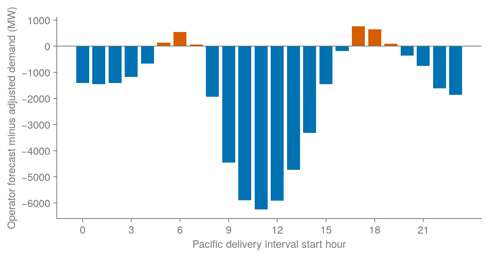

# California grid analytics report

## Business questions and decisions

The release supports retaining operator forecasts and auditing demand definitions before considering a model shadow trial. Across 265 matched delivery days, the geometric mean of the five authority-level model-to-operator MAE ratios was 1.471, with a one-sided 95% upper bound of 1.571. A ratio of 1 denotes parity. The result supports retaining the operator forecasts across the five authorities. The model recorded lower mean daily errors for CISO (1,486 versus 2,161 MW) and LDWP (243 versus 305 MW), but interpreting those differences requires checking demand definitions and hour alignment.

The forecast comparison asks whether a local issue-time model improves proportional error across the California authorities. A separate revision question asks which hours enter or leave a retrospective review queue when EIA changes demand. The event question asks whether a composite daily ranking captures documented alerts at the same review workload as a demand-only rule.

BANC's retrospective queue changed from 2 to 0 to 3 flagged hours as adjusted readings and then the revised peak were applied. In 2024, both rules captured 0 of 1 catalog event days at a 12-day review budget. No qualifying event days occurred in 2025. Recall is undefined when no qualifying event exists.

No adoption margin has been specified. The frozen comparison does not justify deployment. The review queue is an analyst workload device. A high score does not establish an emergency or causation.

## Related work

Load forecasting research favors clear baselines and careful use of weather and calendar information (Hong & Fan, 2016; Hyndman & Athanasopoulos, 2021). Gradient boosting performed well in GEFCom2012 (Ben Taieb & Hyndman, 2014). LightGBM (Ke et al., 2017) and Prophet (Taylor & Letham, 2018) provide practical model choices, but neither guarantees improvement over an operator with access to weather forecasts. This project uses no future observed weather and treats its archived comparison as retrospective because original publication vintages are unavailable.

Accuracy measures affect the conclusion. Hyndman and Koehler (2006) explain problems with percentage errors near zero. Davydenko and Fildes (2013) motivate geometric-mean relative MAE, which gives small and large authorities equal proportional weight. Künsch (1989) supports resampling blocks of dependent observations; this release resamples delivery days jointly across authorities. Diebold and Mariano (1995) and Harvey et al. (1997) provide tests and a small-sample correction for additional comparisons. Those tests are recommendations for future analysis, not completed release evidence.

Data cleaning also changes what a forecast is judged against. Ruggles et al. (2020) screen and impute hourly electricity demand; de Chalendar and Benson (2021) reconcile electricity data using physical balances. These studies motivate checking demand definitions and revisions before interpreting a lower error as better forecasting. EIA monitor documentation and CAISO OASIS documentation supply the operational definitions. Their archived data do not establish what was available at forecast issue time.

Composite indicators require external validation and sensitivity checks (Nardo et al., 2008). Saito and Rehmsmeier (2015) motivate precision and recall for rare events, while Fagerland et al. (2013) compare paired binary tests. Here documented CAISO alerts supply independent labels, and both rankings receive the same review budget. The sparse event record does not support a detector-superiority claim. Paired-test recommendations do not imply that such a test has been run.

The longer literature review identifies four gaps, understood as findings of a narrative search rather than proof that no prior work exists. **First, operator benchmarking:** existing gray-literature comparisons narrow the novelty claim; this project contributes explicit issue-time assumptions, proportional scoring and dependence-aware intervals. **Second, revision consequences:** it traces how revised readings and revised peaks separately change a review queue. **Third, composite validation:** it compares a composite with demand alone against documented alerts at equal workload and reports the limits of sparse labels. **Fourth, small-authority coverage:** it reports BANC, LDWP, IID and TIDC separately alongside CISO, so a large system cannot conceal their errors.

## Data and provenance

The forecast comparison uses archived EIA bulk vintages whose digests are recorded in the [source manifest](../data/manifest/benchmark_sources.json). The saved hourly parquet matches the published freeze hash. The separate historical quality snapshot has its own manifest and is not interchangeable with the forecast study's later bulk inputs.

The frozen test begins 2025-04-01 and ends before 2026-01-01. It contains 33,005 intended authority-hours. Eligibility leaves 31,794 matched hours across 265 common delivery days. Missing observations are not silently filled for evaluation. Source anomalies are flagged and retained. Duplicate handling and observed zeros are explicit quality categories.

Post-freeze OASIS downloads cover spring, summer, autumn and winter weeks. Every accepted ZIP was checked for its report item, market identifier, unique hourly CAISO timestamps, numeric MW values and complete requested coverage. HTTP success alone was insufficient. Raw inputs stay outside version control. The download manifest records request attempts, response outcomes and hashes. The holdout EIA files retrieved for storage checks match their frozen source digests.

Acquisition code first appears in the scoring commit and is outside the frozen code-hash list. The freeze tag was added after scoring and establishes replay resolution, not the time of scoring. See [freeze scope](freeze_scope.md).

## Quality audit and sequential attribution

BANC's retrospective queue changed from 2 to 0 to 3 flagged hours as adjusted readings and then the revised peak were applied. This sequential calculation separates a reading change from a threshold change. It avoids attributing every membership difference to the observation alone.

RQ2 uses authority-hours with both reported and adjusted demand in the historical snapshot. The initial queue divides reported demand by the reported peak, rounds the percentage to two decimals, and applies the fixed threshold. The intermediate queue substitutes adjusted demand while holding that original peak fixed. The final queue also substitutes the adjusted peak. Each transition reports retained, entered and exited hours.

The BANC reported peak is 9,770 MW and the adjusted peak is 3,243 MW. A revised maximum changes the denominator for every eligible hour. The final queue can therefore grow after the anomalous reported spike is corrected. This is a property of the retrospective rule and does not establish a change in actual operational risk.

The audit distinguishes missing calendar hours, observed nulls, zeros and conflicting duplicates. Balance residuals compare demand, net generation and interchange under each target version. Imbalance or a revision is flagged for interpretation rather than deleted to improve a score. The historical queue evidence remains separate from the later full-window forecast evaluation.

## Methodology: issue time and predictors

The model issues its forecast at 12:00 Pacific on the day before delivery. Each hourly record is identified by the UTC time when its interval ends. Its delivery day is the Pacific date when that interval starts. Days therefore keep their actual number of hours when daylight-saving time changes.

To allow for reporting delay, the model uses recent readings only up to 1 hour before issue time. This is an assumption, not proof that the archived version was available then. Later bulk-file revisions may appear in historical model inputs. The archived operator forecast has the same limitation: the bulk file alone does not prove its original publication time.

The model uses delivery hour, weekday and the time from issue to delivery. Demand inputs include the same local hour in the previous week, a recent average and the last reading allowed by the cutoff. If the previous-week local time occurs twice or does not exist because the clocks change, that input is unavailable. Models learn from reported historical demand. Their main retrospective score uses adjusted demand. Saved forecasts can be scored against another demand version without training again.

Training uses only outcomes before the earliest permitted cutoff in the next evaluation window. The entire final validation delivery day is dropped because its outcomes would arrive after the first test forecast was issued. This prevents a boundary leak but cannot recover missing publication vintages. Changing the availability rule requires a new development experiment; it must not change the frozen result.

## Methodology: windows, selection and inference

Models are chosen using a development period from 2025-01-01 up to, but not including, 2025-04-01. The candidates are lightgbm, prophet, previous_week, moving_average. The frozen selection chose lightgbm. The ranking is an observed result; unfavorable authority results are kept.

For each authority and delivery day, we average the size of the hourly errors, ignoring their sign. This is mean absolute error (MAE), measured in MW. Every method is scored on the same matched hours. We then average daily MAE over common eligible days and divide the model's value by the operator's value. Below 1 means the model has lower error. G combines the five authority ratios by taking the exponential of their average logarithm: their geometric mean. Each authority receives equal proportional weight and each eligible day receives equal weight within an authority. Pooling MW errors would instead favor large systems.

A day qualifies only if at least 90% of its actual intervals have an observed target and forecasts from every comparator. A day enters the joint comparison only when all authorities qualify. Undefined or nonpositive ratios stop the logarithm-based inference. We report coverage beside the score to make exclusions visible.

To estimate uncertainty, we repeatedly draw blocks of consecutive eligible delivery days, keeping authorities paired, and recalculate the ratios and G. This moving-block bootstrap uses 2,000 draws and random seed 42. The upper bound is the 95% quantile of those draws. Development-period error dependence selected 1-day blocks. The frozen checks with other block lengths give 1-day blocks: 1.571, 3-day blocks: 1.603, 7-day blocks: 1.637, 14-day blocks: 1.646. An upper bound above 1 does not support deployment.

## Methodology: revisions, events and definitions

The checks added after the freeze keep forecasts fixed and change the demand version or hour alignment. Reported and adjusted demand are scored separately. A negative shift pairs a forecast at UTC hour t with demand from an earlier hour. Losing hours at the ends can change which days qualify, so every version reports its own coverage. A shift is a diagnostic; it does not by itself establish the correct clock convention.

For LDWP only, an exploratory storage calculation adds battery net generation when it is negative to adjusted demand. All other authorities keep their targets. The holdout files have no observed dedicated CISO battery values, so they cannot support a CISO storage correction. The calculation removes net charging only when total battery generation is negative. It cannot recover gross charging, separate simultaneous fleet charging and discharge, or subtract integrated, pumped or other storage. Official reporting instructions and the source's definitions must agree before this can be called a corrected target.

OASIS actual demand and day-ahead-market (DAM) reports are matched by UTC interval-ending time. CA ISO-TAC maps to CISO; LADWP maps to LDWP. In the seasonal checks, only these authorities receive replacement targets and, optionally, replacement operator forecasts. Others retain EIA values. Seasonal G is compared with the baseline for those same sampled weeks, not the full-window headline.

For event screening, normalization uses only trailing observations. A day's score is its highest hourly score; a daily coverage rule excludes sparse days. Within each annual window, demand-only and composite rankings select the same number of review days under both reported and adjusted demand. The composite combines normalized demand, import reliance and forecast surprise. These same-day inputs support retrospective screening, not a day-ahead alert claim. Catalog coverage is checked and missed alerts are retained. Recall is undefined in a year with no qualifying events.

## Results: frozen headline

Across 265 matched delivery days, the geometric mean of the five authority-level model-to-operator MAE ratios was 1.471, with a one-sided 95% upper bound of 1.571. A ratio of 1 denotes parity. The result supports retaining the operator forecasts across the five authorities. The model recorded lower mean daily errors for CISO (1,486 versus 2,161 MW) and LDWP (243 versus 305 MW), but interpreting those differences requires checking demand definitions and hour alignment.

| Authority | Model daily MAE (MW) | Operator daily MAE (MW) | Ratio |
| --- | ---: | ---: | ---: |
| BANC | 174.0 | 55.3 | 3.145 |
| CISO | 1,486.5 | 2,160.6 | 0.688 |
| IID | 53.5 | 28.7 | 1.862 |
| LDWP | 243.1 | 304.7 | 0.798 |
| TIDC | 24.2 | 11.3 | 2.141 |
| **G (geometric mean)** | | | **1.471** |

Coverage is 31,794 matched authority-hours from 33,005 intended over 265 matched delivery days. Reported-demand sensitivity gives G = 1.455. The upper bound remains above parity, so changing the retrospective target does not provide systemwide adoption evidence.

BANC's retrospective queue changed from 2 to 0 to 3 flagged hours as adjusted readings and then the revised peak were applied. The queue result is descriptive and concerns the separate historical quality snapshot.

## Results: post-freeze sensitivity

In the April, July and October daylight-time weeks, EIA CISO demand matched OASIS actuals with a mean absolute difference of 67 to 152 MW after a one-hour shift, compared with 824 to 1,192 MW unshifted. In the December standard-time week, the unshifted series fit best at 241 MW. These four weeks indicate a one-hour labeling offset in EIA CISO demand during daylight time. The operator forecast’s midday shortfall persists against OASIS actuals and remains unexplained. The EIA files report no CISO battery generation. G exceeds parity in every variant. The full-window estimates range from 1.164 to 1.471. Seasonal OASIS substitutions reach 2.025.

| Post-freeze target variant | G | Upper bound | Days |
| --- | ---: | ---: | ---: |
| adjusted shift -1 | 1.169 | 1.216 | 265 |
| adjusted shift +0 | 1.471 | 1.571 | 265 |
| adjusted shift +1 | 1.205 | 1.256 | 265 |
| reported shift -1 | 1.164 | 1.210 | 263 |
| reported shift +0 | 1.455 | 1.544 | 263 |
| reported shift +1 | 1.200 | 1.247 | 263 |
| seasonal original adjusted | 1.365 | 1.719 | 27 |
| seasonal oasis actual | 1.988 | 2.479 | 27 |
| seasonal oasis actual and operator | 2.025 | 2.539 | 27 |
| adjusted ldwp net battery charging proxy | 1.469 | 1.560 | 264 |

The storage proxy and shifted targets do not change the published headline. Seasonal OASIS substitutions have a different support from the full-window comparison. Their per-authority ratios and coverage are available in the [sensitivity JSON](../outputs/metrics/forecast_sensitivity.json).

CISO operator mean bias is -1,773.4 MW and LDWP mean bias is -264.7 MW under adjusted demand. Persistent level and hour-of-day differences support further definition checks. They do not establish which demand convention should be used.

In 2024, both rules captured 0 of 1 catalog event days at a 12-day review budget. No qualifying event days occurred in 2025. Recall is undefined when no qualifying event exists. The event catalog is too sparse to establish detector superiority.

## Limitations and ethical considerations

The strict full-JSON frozen replay fails in the tested environment. Two repeated fits are identical within that environment. Only Prophet authority metrics differ from the publication. LightGBM, authority, previous-week, moving-average and headline fields match exactly. The fit sets no explicit Prophet seed or thread count. The original runtime is unavailable and the cause remains unresolved. The published JSON has been preserved.

The retrospective source archive cannot establish original release-time availability. Adjusted targets can differ from operationally observed demand. The storage proxy cannot identify a physically complete demand correction. Hour shifts can reduce error simply by aligning recurring shapes differently. Seasonal OASIS checks are a limited sample rather than a full-period reconstruction.

Small authorities have equal proportional weight in G. This is a stated decision metric rather than a claim about total system MW impact. The adoption margin remains unspecified. Peak-hour performance and coverage must accompany the aggregate. A sparse alert catalog prevents stable precision or recall comparisons, and transmission-driven events need predictors beyond demand.

The analysis uses public aggregate operational records and contains no customer-level demand. Its main ethical risk is overstating reliability, emergency detection or model readiness. Preserve flagged anomalies, disclose missing forecasts, separate unavailable output from zero demand, and retain source revisions for audit. Avoid presenting a retrospective score as a dispatch recommendation or a warning service.

## Engineering, monitoring and next steps

The release demonstrates isolated fixture execution and transactional interval publication. 

The interval stage requires unique complete authority-hour coverage within a half-open UTC interval. A manifest hashes the staged payload. Publication uses one transaction for revision history, current values and batch metadata. An injected failure leaves prior data intact. A retry publishes the complete interval, and an older replay cannot supersede a newer vintage. The forecast-status table separately records unavailable output and timely authority fallback.

Monitoring should track the most recent complete publication, expected authority-hours, duplicate and null counts, source-vintage changes, unavailable forecasts and operator fallback latency. Investigate definition drift when persistent hourly bias changes. Retain separate target-version dashboards rather than mixing revised and reported demand.

### Verification status

| Item | Status | Evidence |
| --- | --- | --- |
| Fixture pipeline | Verified | 48 tests passed in the hosted fixture step. |
| PostgreSQL transaction | Verified | Hosted PostgreSQL service test passed. |
| Frozen replay | Partial | All fields outside Prophet matched. |
| Continuous deployment | Not verified | No observed unattended service run. |

## References

Ben Taieb, S., & Hyndman, R. J. (2014). A gradient boosting approach to the Kaggle load forecasting competition. *International Journal of Forecasting, 30*(2), 382-394. https://doi.org/10.1016/j.ijforecast.2013.07.005

California Independent System Operator. (n.d.-a). *Grid emergencies history report: Summary of restricted maintenance operations, Flex Alerts, transmission and energy emergencies issued from May 2022 to present*. https://www.caiso.com/documents/grid-emergencies-history-report-1998-to-present.pdf

California Independent System Operator. (n.d.-b). *Open Access Same-time Information System (OASIS) frequently asked questions (FAQ)*. https://www.caiso.com/documents/oasis-frequently-asked-questions.pdf

Davydenko, A., & Fildes, R. (2013). Measuring forecasting accuracy: The case of judgmental adjustments to SKU-level demand forecasts. *International Journal of Forecasting, 29*(3), 510-522. https://doi.org/10.1016/j.ijforecast.2012.09.002

de Chalendar, J. A., & Benson, S. M. (2021). A physics-informed data reconciliation framework for real-time electricity and emissions tracking. *Applied Energy, 304*, Article 117761. https://doi.org/10.1016/j.apenergy.2021.117761

Diebold, F. X., & Mariano, R. S. (1995). Comparing predictive accuracy. *Journal of Business & Economic Statistics, 13*(3), 253-263. https://doi.org/10.1080/07350015.1995.10524599

Fagerland, M. W., Lydersen, S., & Laake, P. (2013). The McNemar test for binary matched-pairs data: Mid-p and asymptotic are better than exact conditional. *BMC Medical Research Methodology, 13*, Article 91. https://doi.org/10.1186/1471-2288-13-91

Granger, C. W. J. (1969). Investigating causal relations by econometric models and cross-spectral methods. *Econometrica, 37*(3), 424-438. https://doi.org/10.2307/1912791

Harvey, D., Leybourne, S., & Newbold, P. (1997). Testing the equality of prediction mean squared errors. *International Journal of Forecasting, 13*(2), 281-291. https://doi.org/10.1016/s0169-2070(96)00719-4

Hong, T., & Fan, S. (2016). Probabilistic electric load forecasting: A tutorial review. *International Journal of Forecasting, 32*(3), 914-938. https://doi.org/10.1016/j.ijforecast.2015.11.011

Hong, T., Pinson, P., & Fan, S. (2014). Global Energy Forecasting Competition 2012. *International Journal of Forecasting, 30*(2), 357-363. https://doi.org/10.1016/j.ijforecast.2013.07.001

Hong, T., Pinson, P., Fan, S., Zareipour, H., Troccoli, A., & Hyndman, R. J. (2016). Probabilistic energy forecasting: Global Energy Forecasting Competition 2014 and beyond. *International Journal of Forecasting, 32*(3), 896-913. https://doi.org/10.1016/j.ijforecast.2016.02.001

Hyndman, R. J., & Athanasopoulos, G. (2021). *Forecasting: Principles and practice* (3rd ed.). OTexts. https://otexts.com/fpp3/

Hyndman, R. J., & Koehler, A. B. (2006). Another look at measures of forecast accuracy. *International Journal of Forecasting, 22*(4), 679-688. https://doi.org/10.1016/j.ijforecast.2006.03.001

Ke, G., Meng, Q., Finley, T., Wang, T., Chen, W., Ma, W., Ye, Q., & Liu, T.-Y. (2017). LightGBM: A highly efficient gradient boosting decision tree. In I. Guyon, U. von Luxburg, S. Bengio, H. Wallach, R. Fergus, S. Vishwanathan, & R. Garnett (Eds.), *Advances in neural information processing systems* (Vol. 30). Curran Associates, Inc. https://proceedings.neurips.cc/paper_files/paper/2017/hash/6449f44a102fde848669bdd9eb6b76fa-Abstract.html

Künsch, H. R. (1989). The jackknife and the bootstrap for general stationary observations. *The Annals of Statistics, 17*(3), 1217-1241. https://doi.org/10.1214/aos/1176347265

Makridakis, S., Spiliotis, E., & Assimakopoulos, V. (2020). The M4 competition: 100,000 time series and 61 forecasting methods. *International Journal of Forecasting, 36*(1), 54-74. https://doi.org/10.1016/j.ijforecast.2019.04.014

Makridakis, S., Spiliotis, E., & Assimakopoulos, V. (2022). M5 accuracy competition: Results, findings, and conclusions. *International Journal of Forecasting, 38*(4), 1346-1364. https://doi.org/10.1016/j.ijforecast.2021.11.013

Nardo, M., Saisana, M., Saltelli, A., Tarantola, S., Hoffmann, A., & Giovannini, E. (2008). *Handbook on constructing composite indicators: Methodology and user guide*. OECD Publishing. https://doi.org/10.1787/9789264043466-en

Ruggles, T. H., Farnham, D. J., Tong, D., & Caldeira, K. (2020). Developing reliable hourly electricity demand data through screening and imputation. *Scientific Data, 7*, Article 155. https://doi.org/10.1038/s41597-020-0483-x

Saito, T., & Rehmsmeier, M. (2015). The precision-recall plot is more informative than the ROC plot when evaluating binary classifiers on imbalanced datasets. *PLOS ONE, 10*(3), e0118432. https://doi.org/10.1371/journal.pone.0118432

Taylor, S. J., & Letham, B. (2018). Forecasting at scale. *The American Statistician, 72*(1), 37-45. https://doi.org/10.1080/00031305.2017.1380080

U.S. Energy Information Administration. (n.d.). *About the Hourly Electric Grid Monitor*. https://www.eia.gov/electricity/930-content/about.html

Wickramasuriya, S. L., Athanasopoulos, G., & Hyndman, R. J. (2019). Optimal forecast reconciliation for hierarchical and grouped time series through trace minimization. *Journal of the American Statistical Association, 114*(526), 804-819. https://doi.org/10.1080/01621459.2018.1448825
